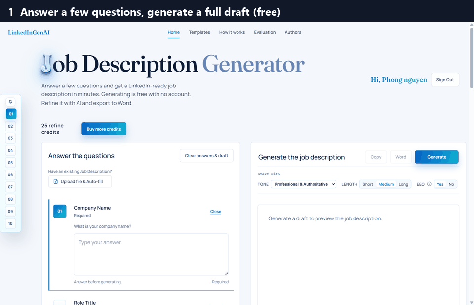
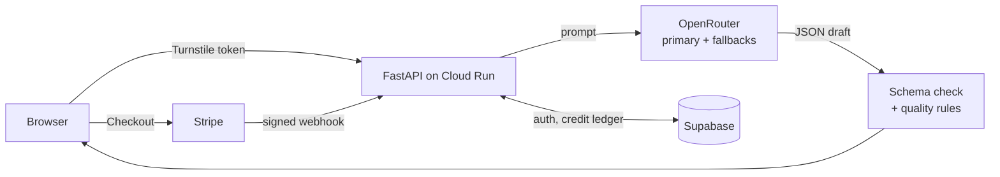
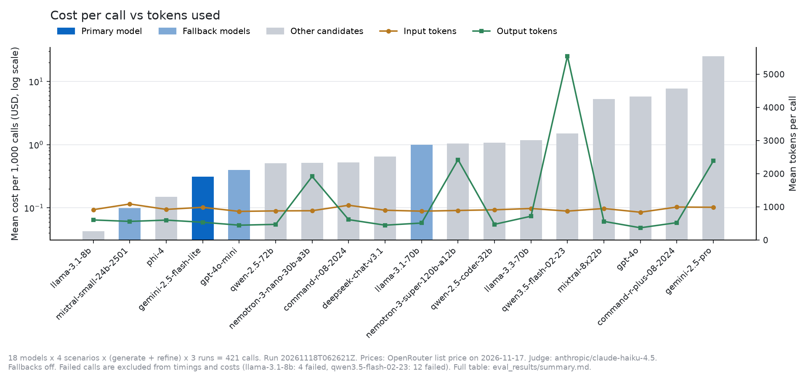
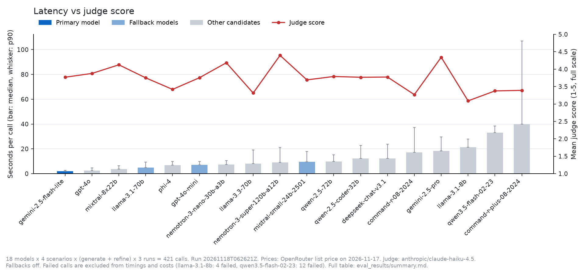

# LinkedInGenAI

## Authors

| **Phong Nguyen (Alex)** | **Huy Phan (Hertzy)** |
|:---|:---|
| **AI Engineering & Database** | **Web Developing & Database** |
| Built FastAPI backend, AI-powered features, Supabase auth/DB, and AI evaluation. Handled SEO (meta tags, structured data) and refined the UI/UX using AI agents for design research and iteration. | Built responsive SPA frontend using HTML5, CSS3, and Vanilla JavaScript (ES6+), integrated client-side document export (docx.js), and designed core relational database schemas in Supabase. |
| GitHub: [@AlexDaPiggie](https://github.com/AlexDaPiggie)<br>LinkedIn: [Hoai Phong Nguyen](https://www.linkedin.com/in/hoai-phong-nguyen-9367a4384/)<br>Portfolio: [Phong Nguyen](https://phongnguyen.vercel.app/) | GitHub: [@hertzy-da-poet](https://github.com/hertzy-da-poet)<br>Portfolio: [Huy Phan Portfolio](https://hertzy-da-poet.github.io/Hugo-Portfolio/) |

---

LinkedInGenAI turns a short role brief into a LinkedIn-ready job description, then lets you refine it, check its wording and export it to Word.

[Live site](https://www.linkedingenai.com) · [2-min demo](https://www.youtube.com/watch?v=-ngDrYsJpZk) · [Architecture](docs/ARCHITECTURE.md) · [Model benchmark](docs/EVALS.md)

[](https://github.com/AlexDaPiggie/LinkedIn_Job_Description_GenAI/actions/workflows/tests.yml) [](LICENSE)



## What it does

- **Structured output, not free text.** The model returns JSON that is validated against a Pydantic schema; broken or cut-off JSON is retried once.
- **Refine in your own words.** Type a change ("make it more senior") and get a full new draft. Changing your answers locks refine until you regenerate, so versions never mix.
- **Quality check with plain rules.** Gender-coded and age-coded words, hype words, missing pay range, bullet caps and reading level. No second AI call, so the same draft always gets the same result.
- **The AI never writes pay.** Pay ranges are added by code from what you typed.
- **Upload and auto-fill.** Upload an old job description; its text is treated as untrusted data and mapped onto the questions.
- **Free to generate, 1 credit to refine.** 20 free credits on signup, then Stripe Checkout packs ($5 = 20, $10 = 40, $20 = 80). Failed refines are refunded automatically.
- **Abuse protection.** Cloudflare Turnstile, per-IP and global daily limits, disposable-email blocking.

## How it works



[](https://www.linkedingenai.com/architecture.html)

*Watch the full 3-minute animated tour, including file upload parsing and the credit ledger, on the [How it works](https://www.linkedingenai.com/architecture.html) page.*

- **FastAPI** serves the API and the static front end from one container.
- **OpenRouter** gives one client for many models; the app tries the primary model, then an ordered fallback list.
- **Supabase** handles sign-in and Postgres. Credits change only through SQL functions with idempotency keys.
- **Stripe** webhooks are signature-checked and credited once per Checkout session.

Details, request lifecycle and code map: [docs/ARCHITECTURE.md](docs/ARCHITECTURE.md).

## Model choice: cost, latency and quality

We benchmarked 18 models on the real generate and refine prompts before picking one. Setup: 4 job scenarios x (generate + refine) x 3 runs = 421 calls on 2026-11-18, fallbacks off, costs from OpenRouter list prices on 2026-11-17, quality scored by `anthropic/claude-haiku-4.5` (not a candidate) at temperature 0.

[](https://www.linkedingenai.com/eval.html)

*Watch the full 4-minute walkthrough, including how each call is scored, on the [Evaluation](https://www.linkedingenai.com/eval.html) page.*





| Model | Role | Median / p90 latency | $ per 1k calls | Term checks | All core sections | Judge (1-5) |
|---|---|---|---|---|---|---|
| `google/gemini-2.5-flash-lite` | primary | **2.0 / 2.7 s** | 0.31 | 22/24 | **19/24** | 3.77 |
| `openai/gpt-4o-mini` | fallback 1 | 7.0 / 9.7 s | 0.40 | 20/24 | 16/24 | 3.75 |
| `mistralai/mistral-small-24b-instruct-2501` | fallback 2 | 9.5 / 17.9 s | **0.10** | 21/24 | 9/24 | 3.69 |
| `meta-llama/llama-3.1-70b-instruct` | fallback 3 | 4.8 / 9.2 s | 1.00 | 18/24 | 9/24 | 3.75 |
| `openai/gpt-4o` | - | 2.4 / 4.7 s | 5.79 | 22/24 | 6/24 | 3.88 |
| `nvidia/nemotron-3-super-120b-a12b` | - | 9.0 / 20.9 s | 1.04 | 22/24 | 7/24 | **4.40** |
| `google/gemini-2.5-pro` | - | 18.3 / 29.7 s | 25.10 | 18/24 | 7/24 | 4.34 |

**Why gemini-2.5-flash-lite.** It was the fastest model (median 2.0 s, p90 2.7 s), completed every call, and was the third cheapest of the models with no failed calls (llama-3.1-8b is cheaper still, but failed 4 of 23). Of the models under 5 s at the median, it filled every core section most often (19/24). The two best-judged models score about 0.6 higher but are 4-9x slower at the median, and gemini-2.5-pro costs about 80x more per call. For a tool people use interactively, we chose speed and reliability over that gap. All 18 models, every metric and the method: [docs/EVALS.md](docs/EVALS.md).

## Design decisions

- **Credits only change inside Postgres**, through one function per operation with a unique key, so retries never charge twice. [0001](docs/decisions/0001-credit-ledger-in-postgres.md)
- **Stripe payments are credited per Checkout session**, and the event is recorded only after the credits land. [0002](docs/decisions/0002-stripe-webhook-idempotency.md)
- **One OpenRouter client with benchmarked fallbacks** instead of one client per provider. [0003](docs/decisions/0003-openrouter-with-fallbacks.md)
- **Free generate, paid refine**, with bot checks and a global cap on the free path. [0004](docs/decisions/0004-free-generate-paid-refine.md)
- **Rules, not a second LLM, for the quality check**: free, instant, repeatable. [0005](docs/decisions/0005-rule-based-quality-check.md)
- **Benchmark with fallbacks off, real prices and an outside judge.** [0006](docs/decisions/0006-eval-harness-design.md)

## Tests

```bash
python -m pytest            # 80 offline tests, about 3 s
python -m pytest -m live    # paid: one real call per model through OpenRouter
```

Offline tests use fakes for the LLM, Supabase and Stripe. They cover billing and limits (credit spend, refunds, webhook signatures and duplicates, rate limits, Turnstile), the quality linter, prompts and parsing, and the benchmark metrics. CI runs them on every push. Security risks and the tests that cover them: [docs/SECURITY.md](docs/SECURITY.md).

## Run locally

Requires Python 3.11+.

```bash
git clone https://github.com/AlexDaPiggie/LinkedIn_Job_Description_GenAI.git
cd LinkedIn_Job_Description_GenAI
pip install -r requirements.txt
cp .env.example .env        # add at least OPENROUTER_API_KEY
uvicorn src.api.main:app --reload
```

Open http://localhost:8000. API docs are at http://localhost:8000/docs. Sign-in and payments also need the Supabase and Stripe keys and the SQL migration - see [docs/DEPLOYMENT.md](docs/DEPLOYMENT.md).

## Limitations

- The benchmark uses 4 synthetic scenarios. It shows relative differences between models, not real-world quality.
- Latency was measured from one location over a few hours; OpenRouter may route a model to different hosts.
- The judge is another LLM. It has known biases (for example toward longer answers), so word counts are reported next to its scores.
- Model prices change; costs use the OpenRouter list price on the date shown.
- Rate-limit counters live in memory and reset when the container restarts.
- The quality check is a screening aid for wording, not legal advice.

## Tech stack

| Layer | Tool | Why |
|---|---|---|
| API | FastAPI, Pydantic | Typed requests and schema-validated LLM output |
| LLM access | OpenRouter (OpenAI SDK) | One client, many models, easy fallbacks |
| Auth and data | Supabase (Postgres) | Email auth plus SQL functions for the credit ledger |
| Payments | Stripe Checkout and webhooks | Hosted checkout, no card data in the app |
| Bot check | Cloudflare Turnstile | Free, no puzzles for real users |
| Front end | Vanilla JS, HTML, CSS, docx.js | No build step; Word export in the browser |
| Hosting | Docker on Google Cloud Run, behind Cloudflare | Scales to zero, one container |

## Where to look

| Path | What lives there |
|---|---|
| `src/api/` | FastAPI app and routes |
| `src/agent/` | Generate, refine and edit logic; prompts; JSON parsing |
| `src/llm/` | OpenRouter client, retries, fallback chain |
| `src/quality/` | Rule-based linter ([its own README](src/quality/README.md)) |
| `src/credits/`, `docs/migrations/` | Credit packs, ledger client, SQL |
| `src/security/` | Rate limits, Turnstile, email checks |
| `src/evaluation/`, `scripts/` | Benchmark harness and chart rendering |
| `eval_results/` | Raw benchmark data, price snapshot, summary table |
| `front_end/` | Static site |
| `tests/` | Offline and live tests |

## License

[Apache License 2.0](LICENSE).
