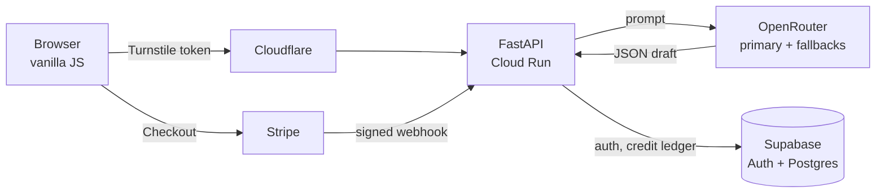
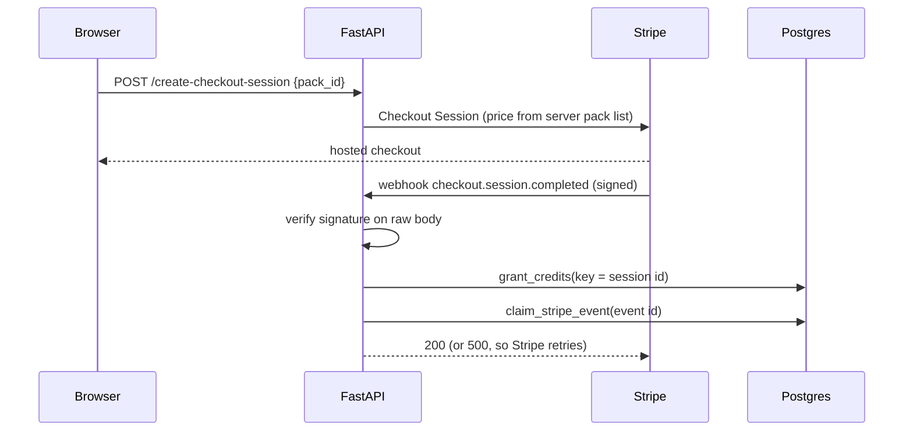

# Architecture

How the app is put together, for someone about to read or change the code.
Read the README first for what the product does.

## Bird's-eye view

A user describes a job. The backend sends one prompt to an LLM, gets back JSON,
validates it against a schema, renders it as LinkedIn-ready markdown, and runs
a rule-based quality check. Generating is free. A typed "Refine" request costs
one credit, which is taken and (on failure) returned inside Postgres.

## Request lifecycle

**Generate** (`POST /generate`, free)

1. `security/limits.py` and `security/turnstile.py` check the bot token, the
   per-IP daily limit and the global daily cap.
2. `agent/prompts.py` builds the prompt: fixed instructions first, user data
   last, wrapped as data.
3. `llm/client.py` calls the primary model and walks the fallback list in
   `llm/models.py` if a call fails.
4. `agent/parser.py` parses the JSON and validates it against
   `schema/job_description.py`. Truncated or broken JSON is retried once.
5. `rendering/markdown.py` renders sections. Pay is added by code from the
   user's input, never by the model.
6. The result streams back as server-sent events. Identical requests are served
   from a small in-memory cache.

**Refine** (`POST /refine`, 1 credit)

1. The user must be signed in. `credits/ledger.py` calls `spend_credits` with a
   unique request key.
2. The model gets the current JSON draft plus the edit request and returns a
   full new draft.
3. If the model fails before sending any text, `refund_credits` returns the
   credit under the same key.

**Buy credits**

## Code map

| Path | What lives there |
|---|---|
| `src/api/` | FastAPI app, routers (`jobs`, `auth`, `payments`, `public`), request schemas, CORS and redirect allowlist |
| `src/agent/` | `JobAgent` (generate, refine, quick edit, section rewrite), prompts, JSON parsing, document upload parsing |
| `src/llm/` | OpenRouter client with retries and ordered fallbacks; model list |
| `src/schema/` | Pydantic models for input (`JobInfo`) and output (`JobDescriptionDraft`) |
| `src/rendering/` | JSON draft to markdown |
| `src/quality/` | Rule-based linter. No network, no LLM. Usable on its own |
| `src/credits/` | Credit packs and the ledger client |
| `src/security/` | Rate limits, Turnstile, disposable-email checks |
| `src/auth/`, `src/database/` | Supabase auth flows and clients |
| `src/evaluation/` | Benchmark harness, scenarios, judge, price snapshot |
| `docs/migrations/` | SQL for the credit ledger tables and functions |
| `front_end/` | Static site served by FastAPI at `/` |
| `tests/` | Offline tests; paid model tests are marked `live` |

## Rules the code never breaks

- **Credits change only through the SQL functions** `spend_credits`,
  `refund_credits` and `grant_credits`. Each takes a unique key, so repeating
  a call never charges or credits twice.
- **No credits without a verified Stripe signature.** Crediting is keyed on the
  Checkout session ID; the event ID is recorded only after crediting succeeds.
- **The service-role key never reaches the browser.** The ledger functions are
  revoked from the public anon role.
- **The model never writes pay.** Pay ranges come from user input and are
  formatted by code.
- **Credit operations fail closed.** If the ledger or the service key is
  missing, refine returns an error and webhooks return 500.
- **Uploaded files are untrusted text.** They are cleaned, capped at 12,000
  characters and wrapped in delimiters; extracted fields are filtered to known
  names and types.
- **Fallback order is configuration** (`MODEL_FALLBACKS`), not logic spread
  through the code.

## Cross-cutting concerns

- **Auth:** Supabase email + password with email confirmation. The API reads a
  bearer token (`api/dependencies.py`).
- **Limits:** in memory, per container. They reset on restart. The client IP is
  read only through `TRUSTED_PROXY_HOPS` trusted proxies.
- **Errors:** users see short messages; full errors go to server logs.
- **Testing:** `pytest` runs offline with fakes for the LLM, Supabase and
  Stripe. See [the README](../README.md#tests).
