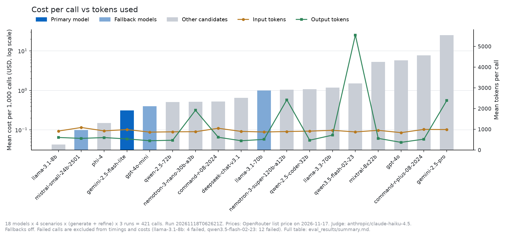
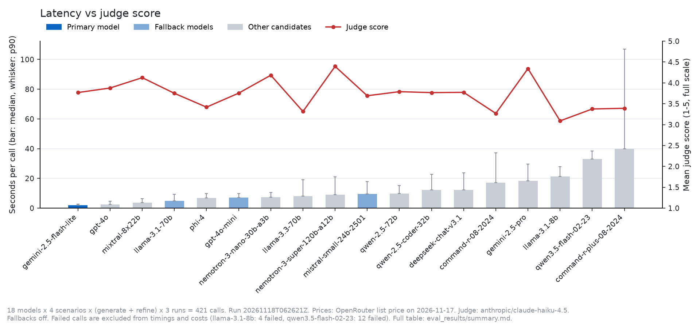

# Model benchmark

How the production model was chosen, and how to reproduce it.

## Setup

| Item | Value |
|---|---|
| Run | `20261118T062621Z`, 2026-11-18 06:26-06:49 UTC |
| Models | 18 OpenRouter models (`src/llm/models.py`), exact slugs in the results |
| Scenarios | 4 hand-written jobs (`src/evaluation/scenarios.py`): required fields only, all fields, sparse, and a complex edge case. Each is generated, then refined with a fixed request |
| Runs | 3 per model and scenario. 18 x 4 x 2 x 3 = 432 planned, 421 recorded (a refine is skipped when its generate fails) |
| Prompts | The production generate and refine prompts, through `JobAgent` |
| Sampling | Provider default temperature for candidates; judge at 0 |
| Fallbacks | **Off.** Each call uses only the model under test. The model OpenRouter reports as serving the call is stored in `served_model`; all 405 successful calls were served by the requested model |
| Retries | Network retries on 429/5xx (up to 3) are kept. The benchmark uses the non-streaming path, which has no JSON retry, so a broken reply counts as a failure. Production streaming retries broken JSON once, so live failure rates should be lower |
| Concurrency | 6 models in parallel; calls for one model run one after another |
| Location | One client on a home connection. Latency includes network and OpenRouter routing |
| Prices | OpenRouter list prices fetched 2026-11-17 (`eval_results/openrouter_prices.json`). Unknown prices stay empty, never guessed |
| Model cost of the run | $1.24 for the 421 candidate calls (judge calls not included) |

## Metrics

| Metric | Definition |
|---|---|
| Calls OK | Returned JSON that validates against `JobDescriptionDraft` |
| Term checks | All `must_include` terms present and no `must_not_include` term (per scenario) |
| All core sections | Title, about the company, about the role, at least one responsibility and one requirement are non-empty |
| No invented pay | No pay figure in the output when the input had none (binary faithfulness check) |
| Latency | Wall-clock time of the LLM call. Median and p90 over successful calls |
| Cost | Provider-reported input and output tokens x list price. Includes reasoning tokens where the model reports them |
| Judge score | Mean of 4 criteria (specificity, tone, faithfulness, LinkedIn readiness), plus refinement quality on refine calls. 1-5 each, averaged in code |
| Words | Output length, reported because LLM judges tend to prefer longer answers |

The judge prompt and parsing are in `src/evaluation/metrics.py`. A judge reply that cannot be parsed is stored as empty with the error, not as 0. In this run there were none.

## Results





The full table for all 18 models is in [`eval_results/summary.md`](../eval_results/summary.md). It is generated from the raw rows, as are the charts.

What stands out:

- **Every model avoided inventing pay** (405/405), so this check does not separate models today. It stays as a regression guard.
- **Section completeness separates models more than the judge does.** Most models leave "about the company" empty when the input has no company description. gemini-2.5-flash-lite filled all core sections in 19/24 calls; most others in 6-9.
- **Reasoning models cost more than their list price suggests.** The nemotron models, gemini-2.5-pro and qwen3.5-flash use 4-10x more output tokens than the median model, because reasoning counts as output.
- **Two models were unreliable.** qwen3.5-flash returned empty content in 12 of 14 calls; llama-3.1-8b failed 4 of 23.
- **Judge scores are close.** 9 of 18 models land between 3.4 and 3.9. The standard error of a model's mean is about 0.1-0.2, so gaps under about 0.3 are within noise.

## Decision

Primary: `google/gemini-2.5-flash-lite` - fastest (median 2.0 s), 24/24 calls OK, third cheapest of the models with no failed calls ($0.31 per 1k calls; llama-3.1-8b is cheaper but failed 4 of 23), and the best section completeness of the models under 5 s at the median (19/24; command-r models score higher but take 17-40 s). The best-judged models (nemotron-3-super, gemini-2.5-pro) score about 0.6 higher but are 4-9x slower; gemini-2.5-pro also costs about 80x more.

Fallbacks, in order: `openai/gpt-4o-mini`, `mistralai/mistral-small-24b-instruct-2501`, `meta-llama/llama-3.1-70b-instruct`. All completed 24/24 calls. By this run, llama-3.1-70b is faster than mistral-small, so the order of the last two could be swapped.

## Limitations

- **Small, synthetic test set.** 4 scenarios written by us. Good for comparing models, not for measuring real-world quality.
- **One judge, not validated against people.** The judge has not been checked against human ratings. It is from a family that is not a candidate, to avoid self-preference, but it can still favor certain styles or lengths.
- **One location, one time window.** Latency depends on network and on which upstream host OpenRouter picks.
- **Prices change.** Costs use the list price on the date above.
- **Term checks are strict string matches.** A model can say "Equal Opportunity Employer" in other words and fail.

## Reproduce

Requires `OPENROUTER_API_KEY`. The full run costs about $1-2 in model calls plus the judge.

```bash
python -m src.evaluation.pricing                 # refresh the price snapshot
python -m src.evaluation.runner --runs 3 --workers 6
python scripts/render_eval_charts.py             # charts + summary table
```

One model only (replaces its rows): `python -m src.evaluation.runner --model openai/gpt-4o-mini`.

## Earlier run

The first benchmark (Aug-Sep 2026) is kept in `eval_results/archive/2026-09_single_run.*`. It ran each model once, used a placeholder price for most models, used gpt-4o-mini as both a candidate and the judge, and could fall back to another model without recording it. Its numbers are not comparable with this run. The fixes are described in [decision 0006](decisions/0006-eval-harness-design.md).
